# one4all4one-fanartstar-bobmorane
Original Retrobat & Batocera Theme

Theme for Emulation Station compatible with
- [Batocera](https://batocera.org/)
- [RetroBat](https://www.retrobat.org/)

Description :

    This theme is a standalone version of the Fanartstar view featured in the All4One4All multi-view theme.
    It's an original theme with fanart priority in mind.

**4 system views, 12 game views, 22 box cases drawn by the theme, 27 built-in help boards, menu in 32 languages.**

Help, news and questions on Discord: https://discord.com/invite/msnaz7Kev7

> All the pictures below are the help boards shipped with the theme. Read them in RetroBat / Batocera:
> *Theme configuration › GENERAL - Welcome message* (English, and French for French users).

---

# Contents
- [Getting started](#getting-started)
- [System views](#system-views)
- [Game views](#game-views)
- [FanartStar Boxart](#fanartstar-boxart)
- [Boxes, cases and discs](#boxes-cases-and-discs)
- [RFE views](#rfe-views)
- [Other game views and common options](#other-game-views-and-common-options)
- [RetroAchievements (optional)](#retroachievements-optional)
- [Customize: your own media](#customize-your-own-media)
- [Folders and grouped systems](#folders-and-grouped-systems)
- [Low-end machine](#low-end-machine)
- [Credits](#credits) · [Français](#français) · [License](#license-)

---

# Getting started
Two settings in the RetroBat / Batocera menus before anything else:
1. *User interface settings › Game medias during fast scrolling*: **required** for the theme to display properly.
2. Scrape these media to enjoy every view: **boxart** (3D box), **thumb** (2D box), **fanart**, **marquee** (logo), **cartridge** (disc / cartridge), **screenshot**, **video** and **boxback** (back of the box, for the flipping box).

All options are in *Theme configuration*, grouped by prefix: GENERAL, SYSTEMS, GAMES, BOXART, ADVANCED…

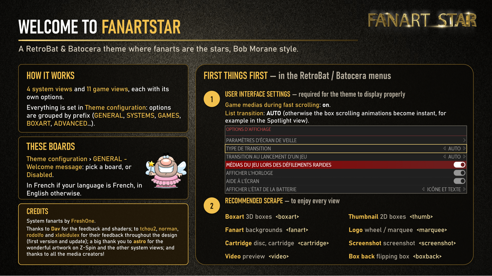

---

# System views
*SYSTEMS - System list view*: **Classic** (default), **Modern 1**, **Modern 2** and **Z-Spin**.

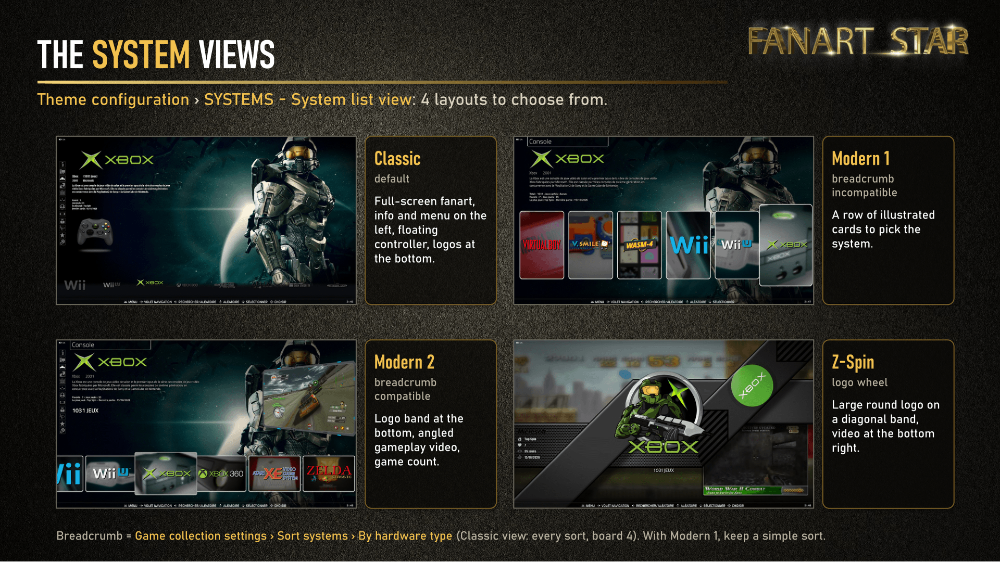

| Classic view: the system image | Classic view: the details |
| ------------- | ------------- |
| 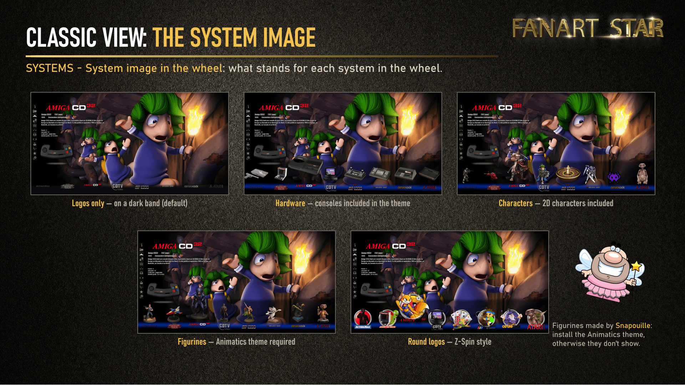 | 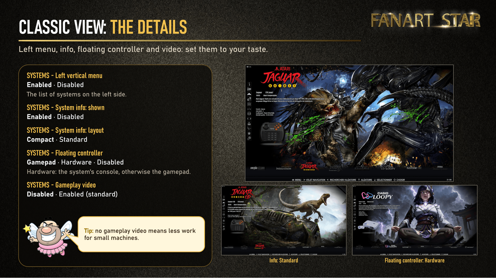 |
| Logos only, hardware, characters, figurines (Animatics theme) or round logos. | Left menu, system info, floating controller (gamepad or hardware), gameplay video. |

The Classic view's left column is a breadcrumb that can follow your system sort: categories, letters, manufacturers or decades.

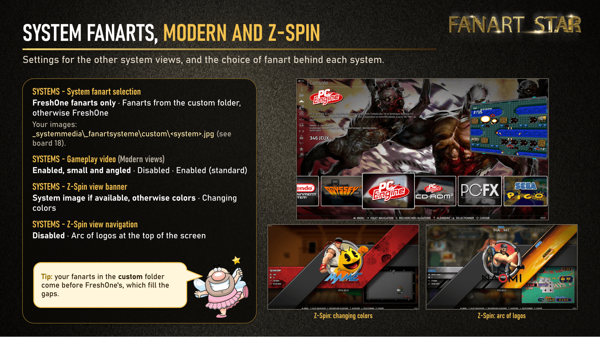

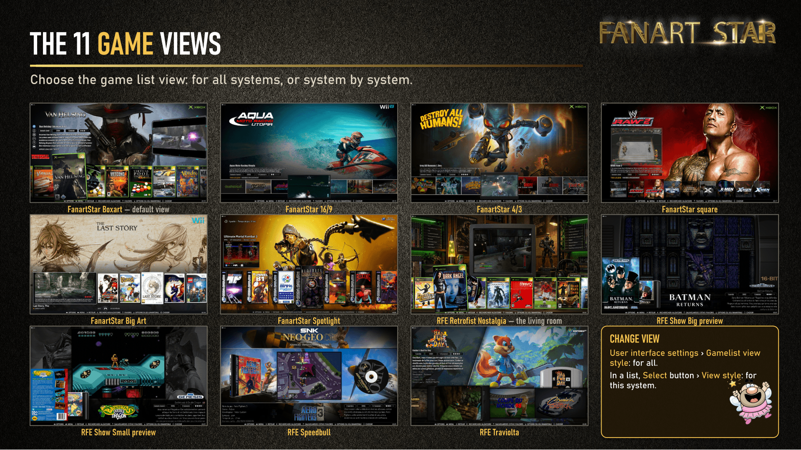

System fanarts by FreshOne; your own fanarts in `_systemmedia\_fanartsysteme\custom\<system>.jpg` come first.

---

# Game views
FanartStar Boxart (default), FanartStar Boxart (Faster navigation), 16/9, 4/3, Square, Big Art, Spotlight, and the RFE views: Retrofist Nostalgia (the living room), Show Big preview, Show Small preview, Speedbull and Traviolta.
Change the view for all systems in *User interface settings › Gamelist view style*, or for one system with *Select › View style* in its list.

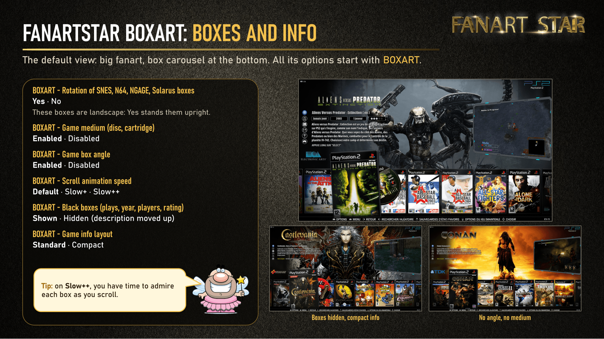

---

# FanartStar Boxart
The default view: big fanart, box carousel at the bottom. Box angle, game medium, scroll speed, info layout… and **22 frames** for the preview video (CRT TV, neon, wood, Polaroid, hologram, animated flames…).

| Boxes and info | The video and its 22 frames |
| ------------- | ------------- |
| 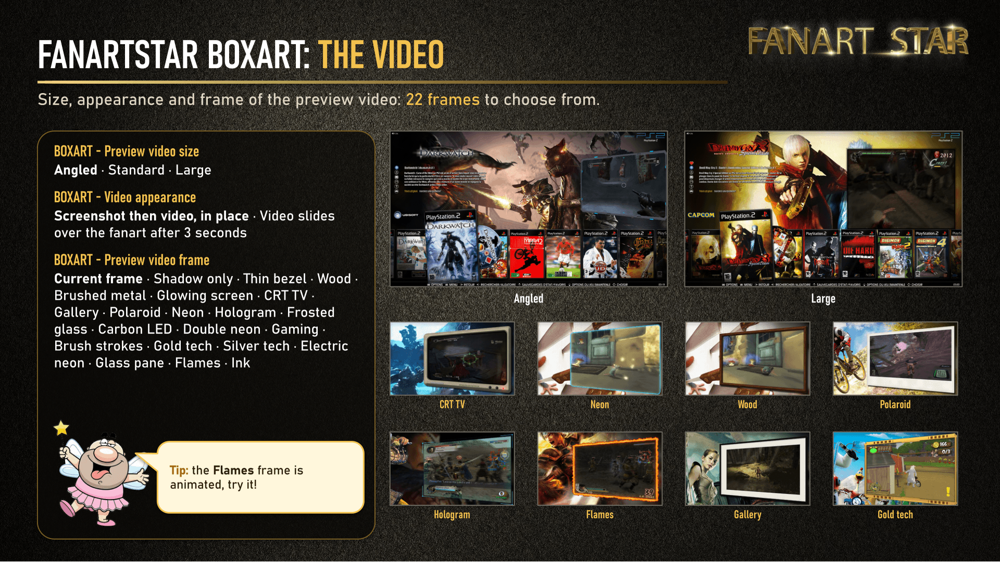 |  |

---

# Boxes, cases and discs
2D or 3D box (*GAMES - Game box to display*). With the 2D box, the theme draws a **real case** around the cover for each console (DVD, Mega Drive, PS1 CD, SNES cardboard, DS, 3DS, PSP UMD, PS3, Dreamcast, cassette…), with transparency, reflections and shadow. Discs spin, the PSP UMD too.

| Boxes and media | The 22 cases |
| ------------- | ------------- |
| 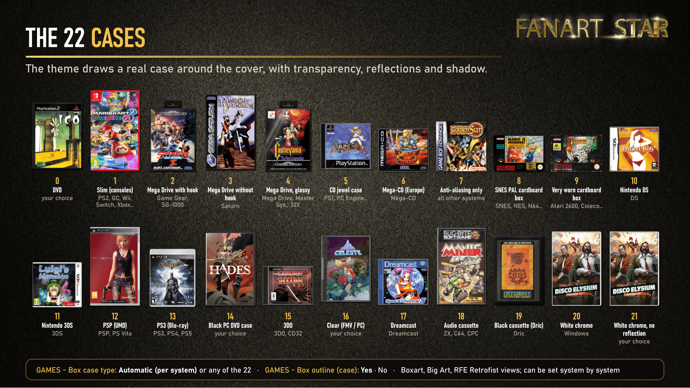 | 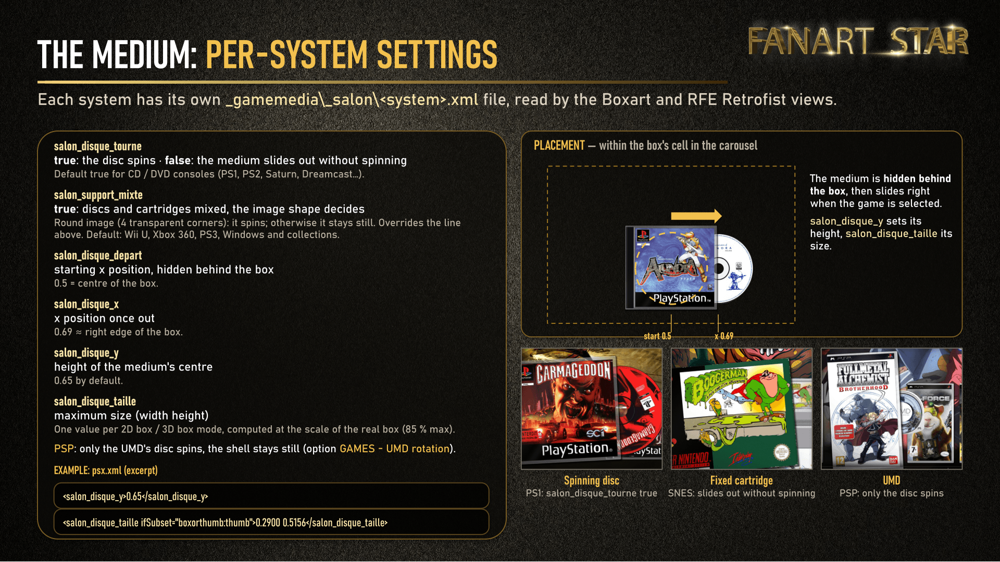 |

Each system has its own `_gamemedia\_salon\<system>.xml` file: does the disc spin, mixed discs and cartridges, position and size of the medium.

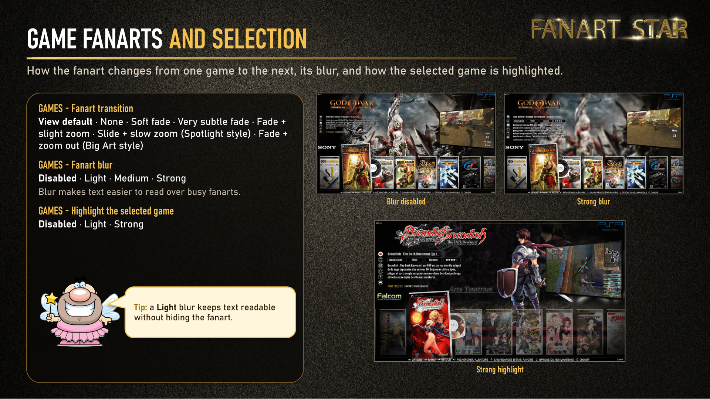

---

# RFE views
**Retrofist Nostalgia**: one living-room background per system, category or collection, the video plays on the TV screen. **Show Big / Show Small**: the box flips over to show its back, **computed live by the theme from your 2D scrapes** (thumbnail + boxback + marquee), no 3D box needed.

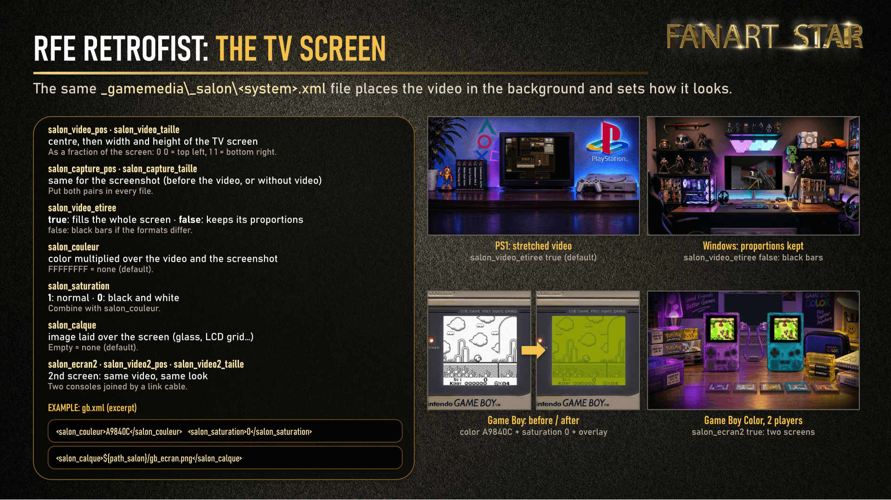

| Retrofist: the TV screen | Show Big & Small: the flipping box |
| ------------- | ------------- |
| 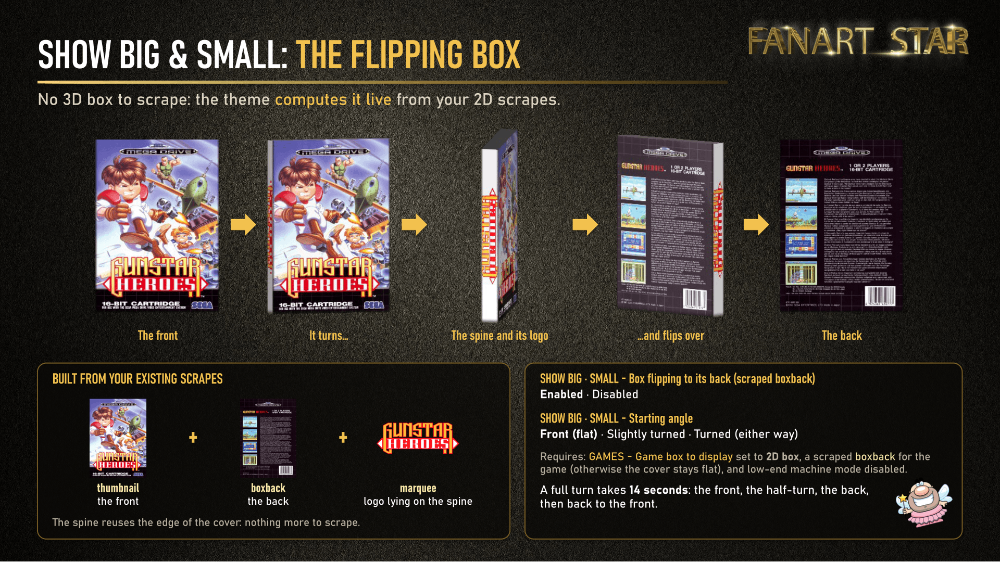 | 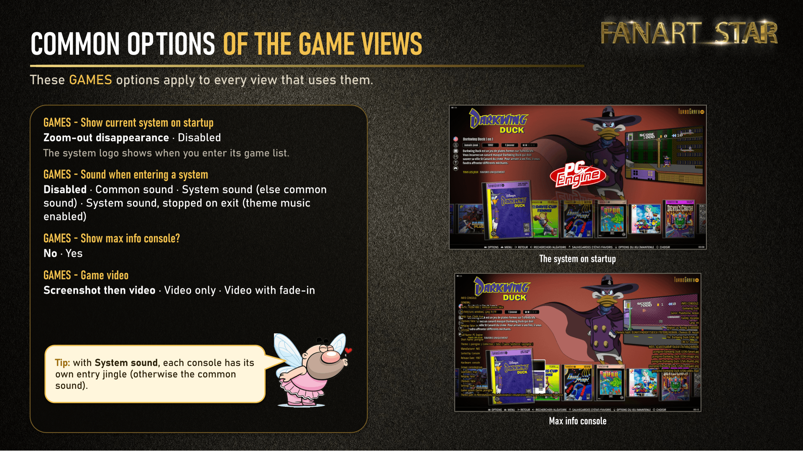 |
| Video position and size, stretching, LCD color, saturation, glass overlay, second screen. | Front, half-turn, spine with its logo, back: a full turn in 14 seconds. |

---

# Other game views and common options

| Game fanarts and selection | Big Art, Spotlight, Square, 16/9 and 4/3 |
| ------------- | ------------- |
|  | 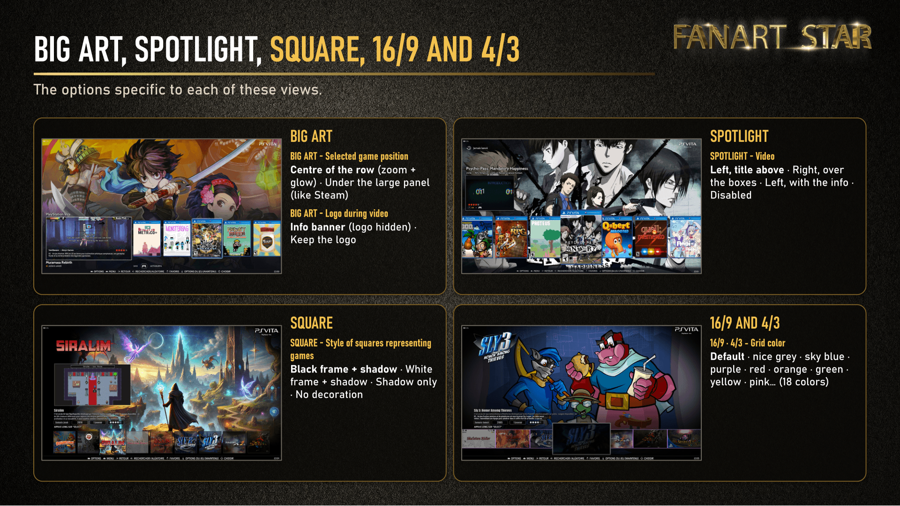 |
| Fanart transition, blur, highlight of the selected game. | Options specific to each of these views. |

| Common options of the game views | General: sounds, help, clock |
| ------------- | ------------- |
|  | 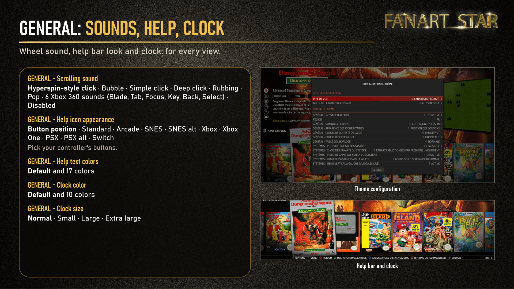 |
| System on startup, entry sound per system, max info console, game video. | Wheel sounds (Hyperspin click, Xbox 360…), help icons for your controller, colors, clock. |

Game name with or without parentheses, rating icon or score as a number, box spacing:

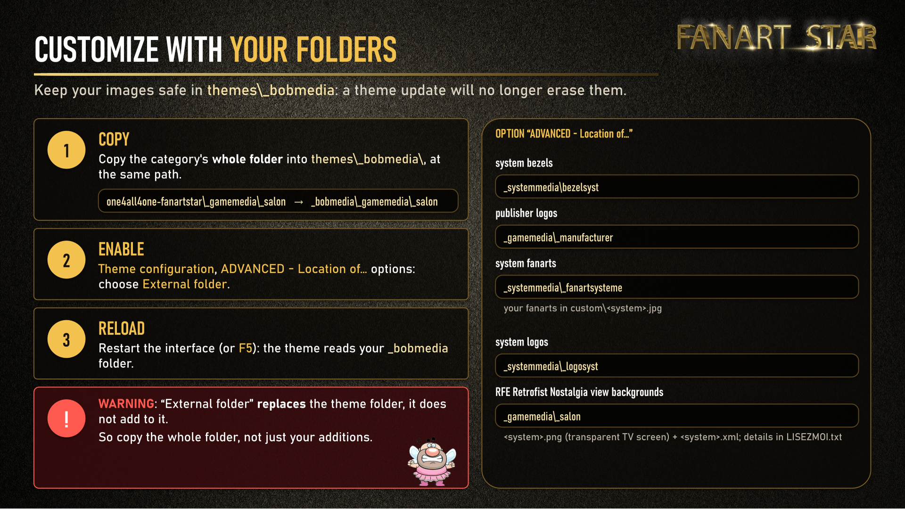

---

# RetroAchievements (optional)
*GAMES - RetroAchievements (external tool)*: **Disabled** (default), **Always visible** or **A few seconds** (the card fades out after 2 seconds).
A small card on the game views shows your avatar, your total points and your progress on the selected game.
It needs a small script to install (RetroBat): `Retroachievements Script.7z`, at the root of the theme. Without it, the theme looks exactly the same.

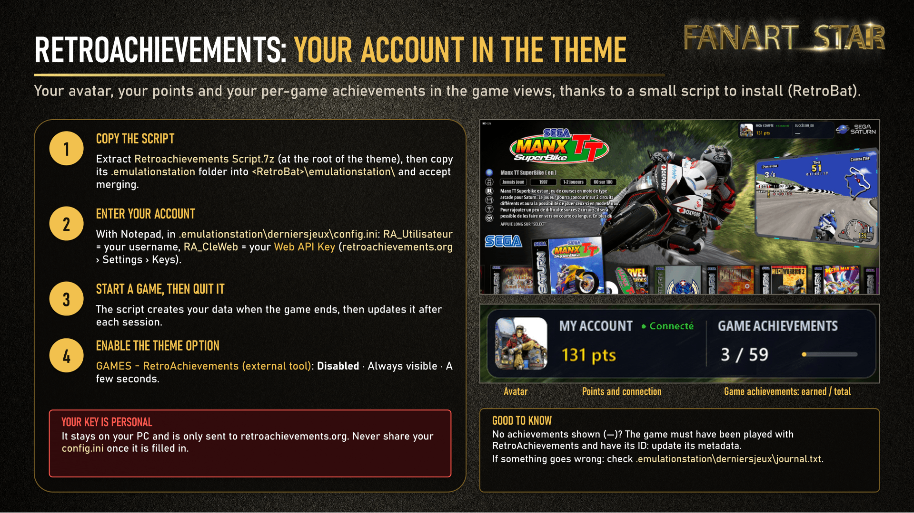

---

# Customize: your own media
**Keep your images safe**: the *ADVANCED - Location of…* options move bezels, publisher logos, system fanarts, system logos and RFE backgrounds to `themes\_bobmedia`, so a theme update never erases them.
**Custom game media**: your own box, logo, fanart, video… for a game, stored by rom name in `_gamemedia\<system>\`, without touching the gamelist or rescraping.

| Customize with your folders | Custom game media |
| ------------- | ------------- |
|  | 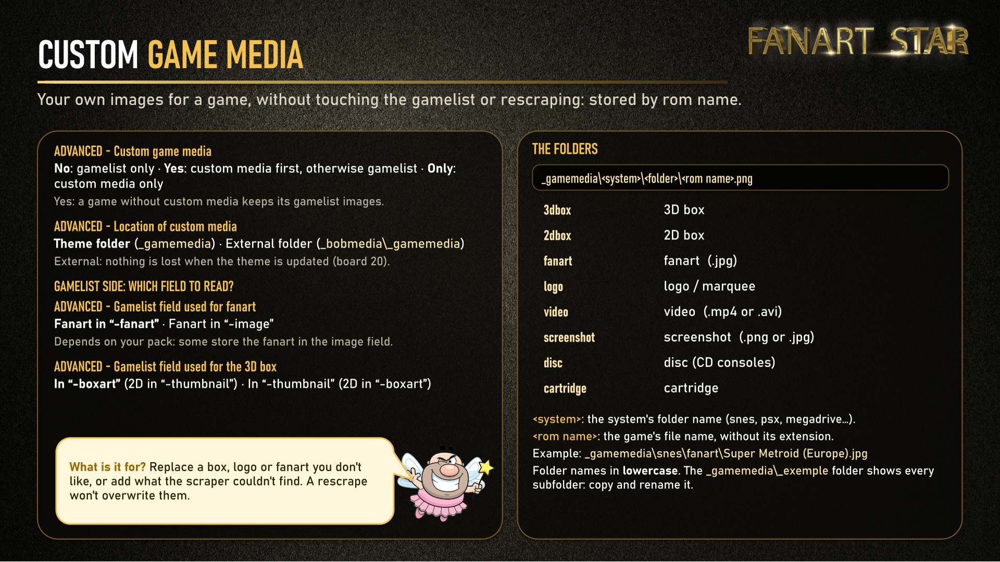 |

---

# Folders and grouped systems
A folder in your game list (`_Euro`, `_USA`, `Traduction`…) can have its own logo, fanart, boxes, screenshot and video: one image named after the folder, in `_gamemedia\_dossiers\` (all systems) or in `_gamemedia\<system>\` (one system only). 20 folder logos are included.
A system grouped inside another one (32X, Mega-CD… inside the Mega Drive) becomes a folder that the theme dresses on its own with the system's logo and fanart.

| Which image wins? | Grouped systems |
| ------------- | ------------- |
|  | 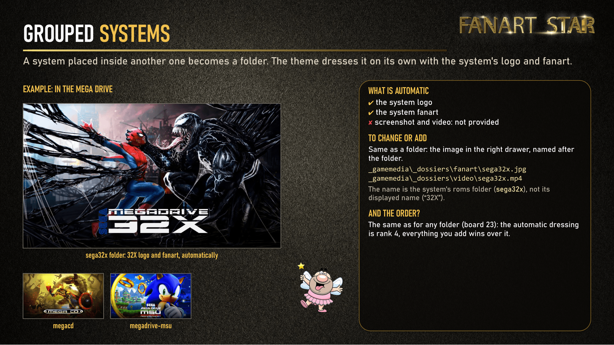 |

---

# Low-end machine
*ADVANCED - Low-end machine mode*: simplified animations, some shaders and decorative effects turned off.

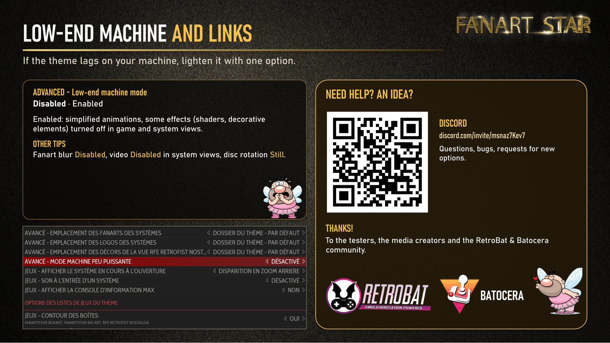

---

# Gallery

| System View Classic Hardware | System View Classic Character | System View Classic Figurine  |
| ------------- | ------------- | ------------- |
|   |   |   | 

| Modern 1 systemview  | Modern 2 systemview
| ------------- | ------------- |
|   |   | 

| Boxart 3D gameview  | Boxart 2D gameview
| ------------- | ------------- |
|   |   | 

| Fanartstar Carre  | Fanartstar 4/3
| ------------- | ------------- |
|   |   | 

| Fanartstar Show Big  | Fanartstar Show small
| ------------- | ------------- |
|   |   | 

| Fanartstar Traviolta  | Fanartstar Speedbull
| ------------- | ------------- |
|   |   | 

| Unique Loading screen per system and per game if you have fanart
| ------------- |
|   |

---

# Credits
Theme by Bob Morane · system fanarts by FreshOne.
Thanks to **Dav** for the feedback and shaders; to tchou2, norman, rodolfo and xlebidulex for their feedback throughout the design (first version and update); a big thank you to **astro** for the wonderful artwork on Z-Spin and the other system views; and thanks to all the media creators!

---

# Français
Thème RetroBat & Batocera où les fanarts sont les stars. Au programme :
- **4 vues systèmes** (Classique, Modern 1, Modern 2, Z-Spin) et **12 vues jeux** (FanartStar Boxart, Boxart Navigation plus rapide, 16/9, 4/3, Carré, Big Art, Spotlight et les vues RFE : Retrofist Nostalgia, Show Big, Show Small, Speedbull, Traviolta) ;
- **22 boîtiers** dessinés par le thème autour des jaquettes 2D, disques et UMD qui tournent, **22 cadres** pour la vidéo de la vue Boxart ;
- la **boîte qui se retourne** des vues Show Big / Small, calculée à partir de tes scraps 2D (thumbnail + boxback) ;
- le **salon rétro** Retrofist : un décor par système, la vidéo sur l'écran de la TV ;
- **tes médias** : déport dans `themes\_bobmedia` (rien n'est perdu à la mise à jour), médias perso des jeux, **habillage des dossiers** et des systèmes groupés ;
- en option, **RetroAchievements** sur les vues jeux (avatar, points, progression sur le jeu), avec un petit script fourni à la racine du thème (RetroBat) ;
- mode **machine peu puissante**, menu traduit en **32 langues**.

**27 planches d'aide** sont intégrées au thème, en français pour les utilisateurs francophones : *Configuration du thème › GÉNÉRAL - Message d'accueil*.

Aide et questions sur Discord : https://discord.com/invite/msnaz7Kev7

### License :
Attribution-NonCommercial-ShareAlike 4.0 International (CC BY-NC-SA 4.0)  
https://creativecommons.org/licenses/by-nc-sa/4.0/
